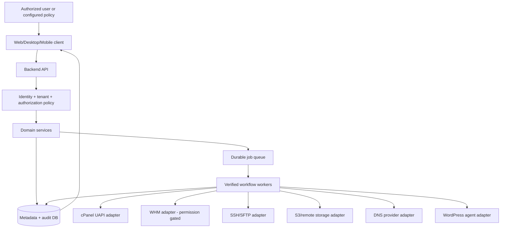

# AI-Native Multi-Hosting Control Platform
## MASTER DEVELOPMENT DIRECTIVE — Version 1.0
**Purpose:** This document is the master instruction for any autonomous engineering agent (Claude Code, Cursor, Gemini CLI, ChatGPT/Codex, or future compatible agent) working on this product. Treat it as a product charter, engineering contract, and execution protocol. It is NOT a claim that features are already implemented.

> **Initial instruction to the executing AI:** Act as the autonomous Product Architect, Principal Engineer, Product Designer, Security Engineer, DevOps Engineer, QA Lead, Technical Researcher, and Project Manager for this repository. Build the real software, not just mockups, plans, or a presentation. Read the repository and its persistent state before changing anything. If the repository is empty, bootstrap it. If existing work is present, preserve and audit it. Carry the highest-value authorized task through implementation, verification, documentation, and a Git checkpoint. Do not mark anything complete without evidence.

---

## 1. Product identity and mission

**Working name:** AI-Native Multi-Hosting Control Platform (renameable through configuration; never hardcode the brand).

**Mission:** Provide a secure, extensible, visually mature, AI-assisted central control plane to connect, observe, operate, migrate, optimize, and automate websites and hosting resources across many independent cPanel accounts, WHM servers, and future hosting providers. Start with an excellent self-hostable web application; later deliver Windows, macOS, Linux/Ubuntu desktop clients and Android/iOS apps that use the same authenticated backend.

**Personas:** independent site owner, WordPress operator, technical agency, multi-client service provider, reseller, hosting administrator, platform operator, and read-only client.

**Initial requirements:**
1. Connect multiple independent cPanel accounts using supported credentials or API tokens; prefer tokens and least privilege.
2. Create a centralized inventory of accounts, hosting providers, domains, subdomains, websites, databases, email accounts, storage, backups, DNS, certificates, PHP versions, and observable health.
3. Migrate an authorized domain/site from account A to B with preflight checks, backups, copy/restore, verification, cutover, and rollback; support account-level WHM paths where permitted and site-level paths otherwise.
4. Make space on account A by safely offloading eligible content to account B or preferably dedicated object storage. Support backup, media, static assets, download archives, and permitted remote databases using clear, validated methods; never pretend that arbitrary shared-hosting disks can be mounted/pool transparently.
5. Manage multiple clients and teams with strict tenant isolation, policies, reporting, and auditable operations.
6. Automate repeatable work with job scheduling, approvals-by-policy, verification, recovery, and observability.

**Core distinction:** This is a management and orchestration platform, NOT an unauthorized replacement for provider/root-level controls. The platform must detect the capabilities actually available to each connected account and adapt the UI and operations accordingly.

## 2. AI-native autonomous execution contract

**Operating style:** Default to execution rather than conversation. Do not repeatedly ask the product owner to approve ordinary planning, repository edits, local tests, dependency installation within established project policy, UI refinements, bug fixes, or pushes to a previously authorized development branch. Make reversible decisions autonomously, record assumptions and rationale, and immediately test them. If a blocking fact cannot be determined, record it as a bounded assumption or blocker and continue with independent tasks.

**Authorization boundary:** The owner authorizes autonomous development and the repository's explicitly allowed environments. Do not infer blanket permission to perform irreversible actions in customer/production hosting accounts. A one-time setup establishes credentials, allowed target environments, action classes, budgets, retention, and approval policies. Respect third-party provider limits and all applicable platform rules. Never bypass permission checks, MFA, provider APIs, payments, or access controls. The product should minimize repeated confirmation by using scoped, revocable policies, not by disabling security checks.

**Action policy (persist in configuration and audit):**
- **AUTO**: research, local development, linting, unit/integration tests with mocks, authorized ephemeral test environments, safe read-only monitoring, backups to approved destinations, idempotent refresh, non-destructive dry runs, screenshots, documentation, authorized Git checkpoint commits and pushes.
- **AUTO WHEN PREAUTHORIZED**: approved staging deployment, reversible remote config updates, selected non-destructive maintenance jobs, verified scheduled backups, migration execution within a scoped and preapproved change window and policy.
- **REQUIRE OWNER/PROVIDER AUTHORIZATION**: unknown third-party accounts, first-time production access, payment, changing credentials/permissions, DNS cutover impacting real traffic, deleting original files, terminating accounts, restoring over live data, irreversible cleanup, and out-of-policy costs. A pre-approved policy may authorize narrowly specified high-impact tasks without repeated confirmation, where supported and appropriate.
- **NEVER**: conceal failures; invent success; exfiltrate secrets to models; silently delete customer data; bypass access rights; disable security logs or backups; claim a transfer is zero-downtime without proof.

When execution is blocked by authorization, build and test the dry-run workflow, expose the blocker precisely, and continue other work. No false claim of 'fully autonomous' if the provider or environment disallows it.

## 3. Source of truth and multi-agent continuity

The Git repository, its committed documentation, and machine-readable project state are authoritative; chat memory is not. Every AI entering the repository MUST, in this order:
1. Inspect repository status, current branch, recent commits, README, and actual project structure.
2. Read root `AGENTS.md`, `docs/PROJECT_STATE.md`, `docs/ROADMAP.md`, `docs/BACKLOG.md` or backlog database exports, `docs/ARCHITECTURE.md`, `docs/DECISIONS/`, `docs/KNOWN_ISSUES.md`, and latest `docs/HANDOFF.md`.
3. Read agent-specific rules (`CLAUDE.md`, `GEMINI.md`, `.cursor/rules/*.mdc`, and relevant scoped `AGENTS.md`). Detect inconsistencies and fix the canonical source before proceeding.
4. Inspect open tasks, blocked dependencies, CI status, artifacts and test evidence.
5. Continue the highest-priority unblocked task. Do not rebuild completed components or repeat already-passing expensive checks unless code or dependency changes justify it.

**Mandatory state files/records:**
- `docs/PROJECT_STATE.md`: concise current factual state, last verified commit, worktree status and environment.
- `docs/NEXT_ACTION.md`: one precise resumable next action, prerequisites, commands, expected result.
- `docs/HANDOFF.md`: last work accomplished, files changed, tests executed/results, risks, blockers, next commit.
- `docs/ROADMAP.md`: milestones and gates.
- `docs/BACKLOG.md` plus `backlog/tasks.json` (or DB + exported JSON): task IDs, scope, priority, status, dependency, acceptance criteria, evidence references, assigned agent, timestamps.
- `docs/KNOWN_ISSUES.md`: reproducible failures, severity, owner, workaround.
- `docs/DECISIONS/ADR-xxxx-*.md`: architecture decision records (considered alternatives, evidence, consequences).
- `docs/RESEARCH/`: dated vendor docs, competitor analysis, technology evaluations, relevant research papers and source links.
- `docs/TEST_EVIDENCE/`: logs, redacted screenshots, test matrices, smoke results, audit reports.
- `docs/RELEASES/`: changelog, artifacts, hashes, release gates, rollback notes.

**Cross-agent rules:** `AGENTS.md` is canonical, succinct and platform-independent. `CLAUDE.md`, `GEMINI.md`, `.cursor/rules/project.mdc` and other tool-specific files adapt its content without contradictory duplications. They must specify exact repo discovery order, commands, coding standards, design standards, risk policy, task protocol, current-state pointers, when to commit, when to stop, and how to resume. Verify actual tool conventions from current official docs instead of relying on memory. Document tools in `docs/AI_AGENT_COMPATIBILITY.md`.

**Session durability:** Never depend on context-window size or credit balance. After each atomic task, or before a long/high-cost tool call, persist working artifacts, update the backlog/handoff, commit changes, and push to the authorized branch if network/auth is available. If capacity/time is uncertain, create a useful intermediate checkpoint early. Do not promise background continuation: the next session must resume from repository state.

## 4. AI pre-development BEFORE feature implementation

Before significant implementation, execute a time-boxed Pre-Development Program and save all outputs:
1. Inspect existing repo; determine greenfield vs brownfield and preserve existing work.
2. Create a capability-versus-permission matrix for shared cPanel credentials, cPanel UAPI token, SFTP, SSH, WHM reseller, WHM root, provider API, DNS registrar, Cloudflare, object-storage services, and optional WordPress companion agent.
3. Define personas, user journeys, jobs-to-be-done, permission matrix, top-20 workflows, failure scenarios, and operational risks.
4. Research official API documentation, supported operations, API version differences, provider restrictions, and migration/restore limitations. Record dates and links.
5. Compare relevant products such as cPanel/WHM, ManageWP/MainWP, Enhance, Plesk, RunCloud, CloudPanel and applicable migration/storage tools. Benchmark concepts and workflows; do not copy protected branding, screenshots, source, or licensed UI.
6. Research academic/technical papers only when materially useful: distributed task orchestration, storage consistency, multi-tenant isolation, least privilege, durable workflows, backup verification, migration consistency, and human-computer interaction. Record evidence quality and tradeoffs. Do not spend unbounded tokens on irrelevant research.
7. Select and defend the stack using a weighted scorecard: installability on VPS and local machines; ability to run on modest resources; security; offline/local development; portability; maintenance; observability; desktop/mobile reuse; licensing; CI cost.
8. Produce diagrams, data model, API contracts, integration adapter specs, domain boundaries, security threat model, UI design brief, test strategy, release strategy, installation strategy and execution backlog.
9. Implement one narrow technical proof of concept for cPanel read-only inventory using a mock adapter (and a real test account only if authorized), and one end-to-end local demo workflow.
10. Mark Pre-Development complete only when the actual files are present, internally consistent, reviewable and approved by automated quality gates; then start incremental development. Do not block on aesthetic perfection or infinite research.

**Outputs:** `docs/PRODUCT_SPEC.md`, `docs/FEASIBILITY_MATRIX.md`, `docs/ARCHITECTURE.md`, `docs/DATA_MODEL.md`, `docs/SECURITY_THREAT_MODEL.md`, `docs/INTEGRATIONS.md`, `docs/DEPLOYMENT_MATRIX.md`, `docs/UX_SPEC.md`, `docs/TEST_STRATEGY.md`, `docs/RESEARCH/*`, initial ADRs, and backlog.

## 5. Full feature catalog and system scope

### A. Connections & capability discovery
- Secure connection onboarding, credential/token vault references, revalidation, expiration/revocation detection, connection grouping, server/provider metadata, health and latency.
- Capability profiles per account and operation: `supported`, `read_only`, `requires_whm`, `requires_ssh`, `requires_provider`, `not_available`, `unknown`.
- cPanel UAPI connector, WHM API connector, SFTP/SSH connector, DNS provider connector, object storage connector, WordPress agent; extensible interface for future panels.
- Rate limits, retry/backoff, timeout, audit, idempotency, circuit breakers and API version adapters.

### B. Unified dashboard and inventory
- Global account summary, tenants and client workspaces, sites/domains/subdomains, addon/parked/aliases where supported, DNS zones, SSL/TLS, PHP and databases, accounts/mailboxes, file usage, quotas and trends.
- Sort/filter/search, saved views, bulk selection, custom widgets, capacity maps, charts with last-fetched timestamps and stale-data labels.
- Distinguish server capacity, account quota and remote/object-storage capacity. Never sum unlike resources as if interchangeable free disk.

### C. Domains, websites and DNS
- Domain discovery, ownership/connection validation, site-to-account mapping, domain/subdomain operations where supported, document roots, PHP settings, DNS record editor where authorized, nameservers, redirects and SSL lifecycle.
- DNS propagation tracking, split DNS scenarios, TTL preflight and record snapshots; never assume the app controls registrar records.
- Website clones, staging, deployment preview, snapshots and environment comparisons.

### D. Migration and transfer engine
- Site-level and account-level strategies; WordPress-first optimized path, generic PHP site path, WHM full account transfer path when permitted; email and DNS treated as separate migration workstreams.
- Dry-run feasibility, source/destination compatibility, storage and inode checks, PHP/extensions, database versions, paths, DNS/MX/email implications, quota/backup space, expected downtime and costs.
- Snapshot, resumable file transfer with checksums, database export/import with integrity check, config rewrite, optional delta sync, temporary destination preview, health tests, DNS cutover under policy, verification, rollback window, cleanup only after retention and success evidence.
- State machine: `planned -> preflight -> snapshot -> transfer -> restore -> verify -> ready_for_cutover -> cutover -> monitor -> completed`; explicit `blocked`, `failed`, `rolled_back` branches.
- Idempotent retries, compensating actions, resumable checkpoints; never delete the source first. Sensitive/transaction-heavy sites need maintenance windows or consistency strategies. Avoid unconditional 'zero downtime' promises.
- Bulk migration scheduler, target recommendation engine, conflict detection, duplicate-domain safeguards and audit trails.

### E. Smart storage manager — realistic engineering
- Storage observability, trend predictions, source/destination eligibility, configurable thresholds, rules and dry-run savings estimates.
- Offloading modes: **object-storage media offload**, **remote static/download file serving**, **approved backup archival**, **remote database hosting if network and host permissions allow**, **root-controlled network mounts only in eligible VPS/owned infrastructure**.
- Account B can act as a remote storage target ONLY if an appropriately authorized and secure storage service is exposed and fit for purpose. A normal cPanel account's spare disk is not automatically shared filesystem space for A.
- Implement file inventory/classification, content hashes, object manifests, reference URL rewrites where safe, signed URLs/CDN options, path traversal prevention, encryption, access validation and restore/re-hydration.
- Make WordPress media offload a plugin/agent-supported workflow. Test that the site still works when remote storage is inaccessible and specify fallback behavior.
- Never move live application files/database assets by guessing, never rewrite database references without tested backup and rollback, never delete local copies before end-to-end verification and retention gate.
- Recommend S3-compatible object storage as the general-purpose durable target where feasible; compare cost/egress/availability rather than pretending shared cPanel is a reliable backup service.

### F. WordPress operations
- Detect WP installs, versions, plugin/theme inventories, update statuses, core/plugin/theme updates, snapshots, staging, clone and migrate, database cleanup, health and uptime monitoring, logs and security scanning integrations.
- Design companion WordPress plugin and/or WP-CLI connector as necessary. cPanel credentials alone do not grant WordPress admin or plugin API permissions.
- Rollback preconditions, dependency compatibility and test-first updates; avoid destructive DB cleanup without recovery path.

### G. Databases, email, files and backups
- DB inventory, permission-aware create/export/import/restore, remote DB checks, version/charset compatibility, size and query health monitoring.
- Mailbox discovery, quotas, forwards, DNS/MX/SPF/DKIM/DMARC visibility as supported, IMAP migration workflows with privacy, rate controls and message integrity.
- Cross-account file explorer, secure copy, read-only preview, permission/ownership checks, large-file chunking, progress and checksum verification.
- Encrypted on/off-site backups, schedule, retention, restore drills, partial/file/DB restore, object immutability where supported, recovery catalog, RPO/RTO configuration and evidence.
- Distinguish provider full-account restore (may require WHM/host) from app-level partial site restoration.

### H. Operations and automation
- Policy-driven jobs: threshold alerts, automated reports, backups, validated cleanup suggestions, certificate expiry warnings, downtime checks, capacity recommendations, controlled batch updates, migration scheduling, drift detection.
- Rules builder with conditions/actions, preview, guardrails, circuit breaker, retries, cooldown, deduplication, execution history and emergency stop.
- Email/Telegram/Slack/webhook notifications with rate limiting, redaction and tenant permission checks.

### I. Security, governance, agency and business features
- Organization/team/client workspaces, tenant isolation, RBAC/ABAC, MFA/SSO options, least-privilege access, audited sessions, API keys and scoped service accounts.
- White-label branding, client portal, reporting, usage and cost attribution, export, billing/WHMCS adapters if justified, multi-language architecture, admin help system.
- Plugin marketplace/connector SDK (not necessarily initial release); public versioned API, webhooks, SDK examples, licensing compatibility and backward-compatible migrations.

### J. Built-in AI features (optional, controlled)
- Natural-language read-only questions over inventory, explain capacity anomalies, compare migration options, suggest safe optimizations and generate grounded plans.
- AI must use tool/permission boundaries and cite inventory timestamps. It cannot make up live resource states. Sensitive data to external LLMs must be minimized, redacted, opt-in and policy-controlled; support local AI/provider selection where feasible.
- 'Explain before execute' for high-risk plans, policy engine as the final authorization authority, deterministic actions for infrastructure operations.

## 6. Architecture and data engineering

Adopt **modular monolith first, worker-based execution, clean provider adapters** unless research proves another design better. Avoid premature distributed microservices. Maintain a stable API for all clients.

**Reference logical layers:**
1. Web UI / Desktop UI / Mobile UI.
2. API gateway / authenticated application backend.
3. Tenant, identity, authorization and policy engine.
4. Domain services: accounts, sites, migrations, storage, DNS, backups, notifications, automation, billing.
5. Durable job/workflow engine and asynchronous worker pool.
6. Connector/adapters: cPanel UAPI, WHM, SSH/SFTP, WordPress, DNS/registrar, S3-compatible providers, IMAP.
7. PostgreSQL (metadata, workflows, audit index), Redis/queue as selected, encrypted secrets backend, object store for artifacts.
8. Monitoring/telemetry, CI/CD and reproducible deployment infrastructure.

**Core entities:** Organization, User, Membership, Role, Permission, Client, Provider, Server, HostingAccount, Connection, CredentialReference, CapabilitySnapshot, Domain, DNSZone, DNSRecord, Website, WebsiteEnvironment, Database, EmailAccount, StorageEndpoint, StoragePolicy, StorageObjectManifest, Backup, MigrationPlan, MigrationJob, JobStep, AutomationRule, Event, Notification, AuditEvent, ResearchEvidence, ProductOption, Feature, BacklogTask, TestRun, Release.

All critical entities must have stable IDs, tenant IDs where appropriate, timestamps, provenance, lifecycle state, and soft-delete/retention policy as applicable. Encrypt sensitive fields; secrets should be referenced rather than serialized in jobs or logs. Maintain audit event integrity, correlation IDs, pagination and schema migrations.

**Required diagrams (version-controlled, update on changes):**
- System context, container/component architecture, external trust boundaries, secrets flow, request flow.
- Domain onboarding sequence, WordPress discovery sequence, migration state transition and dataflow, backup/restore and offload dataflow.
- ERD and data dictionary, RBAC decision flow, error/rollback flow, deployment topology and pipeline diagram.
- Produce Mermaid sources under `docs/diagrams/`, plus rendered SVG/PNG as build artifacts when supported. The diagrams must match implemented code, not illustrative fiction.

**Reference dataflow diagram to expand during pre-development:**


## 7. AI-managed knowledge banks

Before implementing major workflows create a searchable, structured, versioned **Knowledge & Execution Bank**. Data is not just prose; define schema, unique IDs, cross-references, version history, validators and export/import.

1. **Flow Bank:** every business/user/automation flow, graph, inputs, preconditions, branching, failures, resume/rollback path, UI entry points and test cases.
2. **Options Bank:** all configurable options with data type, default, validation, capability requirements, security classification, dependencies, scope and help text; prevent UI options with no backend effect.
3. **Systems Bank:** modules, submodules, APIs, connectors, dependency graph, version, status and ownership.
4. **Design Bank:** tokens, components, variants, accessibility rules, screen inventory, interaction states, visual references, responsive patterns and design decisions.
5. **Integration/Capability Bank:** APIs, operations, permission requirements, provider versions, supported/blocked modes, error maps and mock fixtures.
6. **Research & Decision Bank:** official references, competitor findings, papers, license checks, ADRs, confidence and review dates.
7. **Test & Evidence Bank:** requirements-to-tests mapping, recorded runs, fixtures, screenshots, performance baselines and unresolved coverage.
8. **Backlog & Delivery Bank:** epics -> stories -> tasks -> test evidence -> commit -> release mapping.

Persist a canonical `knowledge-bank/` directory (JSON/YAML/MD schemas) or database with reproducible exports. Use it to generate docs, API contracts, UI field schemas, diagrams and backlog views; avoid duplicated manual truth sources. Every option must link to implementation and test evidence or be visibly flagged `not_implemented`.

## 8. AI UI/UX ownership and mature visual quality

AI is fully responsible for design strategy, information architecture, visual language, prototypes, UI components, responsiveness, interaction flows and verification. Don't require the owner to provide missing design ideas. Design an original professional infrastructure-management experience, not a generic admin template and not a screenshot clone.

**UI requirements:**
- Navigation optimized for organizations -> clients -> hosting accounts -> sites -> operations, plus global dashboard, search/command palette, alerts, job center and capacity planner.
- Dense but readable data tables, status semantics, confidence/timestamps, filtering, keyboard navigation, batch actions, accessible forms, clear destructive-state cues, progress and operation logs.
- Light and dark themes with coherent typography, grids, spacing, color system, iconography, empty/loading/error/skeleton states, charts and responsive behavior.
- WCAG 2.2 AA as target; check contrast, focus, screen reader behavior, touch targets and reduced motion where applicable.
- Separate conceptual UX for safe read operations and high-impact operations; explicit preview, evidence and reversal paths.
- Design system with tokens, component inventory, variant matrix, Figma naming conventions, screen map and testable interaction specs.

**Design repository research:** Analyze current GitHub projects including `shadcn-ui/ui`, `mantinedev/mantine`, `tailwindlabs/headlessui`, relevant Radix components and suitable chart/data-grid libraries. Evaluate actual stars and update cadence as one signal, not as proof of quality. Prioritize license, compatibility, accessibility, maintainability, performance, clear contribution rules and quality of implementation. Document selection and alternatives. Do not violate licenses, copy proprietary layouts or indiscriminately mix component frameworks.

**Design maturity gate:** For each key screen, produce normal, loading, empty, error, permission-restricted, mobile/tablet and dense-data states; validate with actual fixtures, screenshot review, visual regression, usability heuristic review and accessible interaction tests. Iterate flaws without asking the owner to identify every spacing issue.

**Special command — `design it`:** When a user says `design it` plus a target tool (e.g., Figma), enter **DESIGN-ONLY MODE**. Read all existing requirements/knowledge banks. Design or refine complete requested screens and flows using that specific available authorized design tool, or generate high-fidelity design artifacts if tool access is absent. Do not modify production backend/frontend application code, databases, deployment or business logic under this command. Exception: design-only preview code or tokens in isolated design artifacts if needed. Mature the design through audit/iterations and save the screen list, components, flow maps, interaction specs, responsive states, export references and evidence. Clearly differentiate design completion from software implementation. If a design tool is unavailable, document exact limitation and produce the best available tool-neutral specification/prototype rather than claiming work was done in that tool.

Additional supported modes: `research it` (research only), `plan it` (architecture/backlog only), `build it` (implement), `audit it` (review/test), `ship it` (authorized release pipeline), `resume` (continue from state), `status` (verified progress, not guesses). Default mode is `resume/build` governed by backlog and access policy.

## 9. Technology selection and cross-platform strategy

Do not lock a stack purely from habit. Compare at least two serious, installable options and write an ADR before choosing. The default candidate to evaluate is:
- **Frontend web:** React + TypeScript, Next.js or Vite-based SPA as architectural fit dictates, Tailwind CSS and a coherent accessible component system.
- **Backend:** TypeScript/NestJS or PHP/Laravel or Go, scored on API ergonomics, queues, memory footprint, operations, local install and security.
- **Data:** PostgreSQL; SQLite option only for explicitly supported local/single-user deployment if feature-equivalent; Redis when needed for durable job coordination with fallback plan.
- **Workflows:** persisted state machine with PostgreSQL-backed jobs/Redis queues as proven, or a justified durable workflow engine.
- **Desktop:** evaluate Tauri vs Electron; Windows, macOS, Linux/Ubuntu installers signed when production distribution requires it; avoid hard dependencies on proprietary runtimes.
- **Mobile:** evaluate React Native/Expo vs Flutter; target Android/iOS using the same versioned API and consistent security policies.
- **Deployment:** Docker Compose for VPS/self-hosting when suitable; optional native/system-service install for supported environments; reverse proxy and TLS, secrets vault, backups, monitoring.
- **API:** OpenAPI schemas, typed clients, versioning, pagination, streaming/progress channels for long jobs.

Design for low-cost VPS and developer laptops. State minimum realistic CPU/RAM/storage per mode after performance testing. Distinguish deployable **central application** requirements from connected cPanel host requirements. Do not promise that a Node/PostgreSQL/worker stack runs on any restrictive shared cPanel account; offer supported deployment targets and explain limitations.

**Platform rollout must be sequential:**
1. First build, stabilize and ship web application + backend + install wizard + API + integrations.
2. Then Windows, macOS and Linux/Ubuntu desktop shells/client features on the stable API.
3. Then Android and iOS apps with mobile-appropriate flows, offline read caching where safe, secure credential storage and push notification support.
4. Shared domain contracts, design tokens, typed API clients and automated tests are reused. Never delay web MVP because desktop/mobile scaffolds are incomplete.

## 10. AI backlog and delivery operating system

Implement a **development backlog in-repo immediately**, plus a visual Backlog/Job Center in the product when that phase is reached. The backlog is not a decorative kanban; it is executable planning, traceability and evidence.

**Task schema:** `id`, `epic`, `title`, `description`, `priority`, `risk`, `phase`, `dependencies`, `status`, `verification_level`, `blocker_type`, `owner_agent`, `assumptions`, `acceptance_criteria`, `test_ids`, `source_references`, `commit_hash`, `evidence_paths`, `blockers`, `started_at`, `completed_at`, `verified_at`, `last_updated`.

**Lifecycle status:** `proposed`, `researched`, `ready`, `in_progress`, `implemented_unverified`, `testing`, `verified`, `blocked`, `deferred`, `reopened`.

**Verification level:** `none`, `static`, `unit`, `mock_tested`, `browser_tested`, `integration_tested`, `live_verified`, `docs_reviewed`. This is the strongest evidence recorded, separate from lifecycle. A blocked task uses `blocker_type` (`environment`, `external`, `technical`) plus an exact blocker and next action. Never use `mock_tested`, `blocked_environment`, or `blocked_external` as lifecycle values; never equate code with verification.

**Backlog screens:** Epics/roadmap, dependency graph, current sprint/work queue, statuses with counts, blockers, CI health, risk, test coverage, job timeline, Git commits, release candidates, and actual completed vs deferred. No fabricated percent completion. Machine-readable reports and human-readable snapshots must agree.

**AI operating loop:**
`inspect -> research -> plan -> choose task -> implement -> test -> review -> document -> checkpoint -> pick next task`

Run independent tasks in parallel only when they do not mutate overlapping files or environments. Prefer one clear critical-path task rather than an uncontrolled swarm of agents consuming credits.

## 11. AI engineering requirements

Apply contract-driven, testable engineering, using strict typing where appropriate, clear domain boundaries, dependency inversion for provider integrations, database migrations, request validation, deterministic errors, schema/version management, structured logs and feature flags.

- Make adapters substitutable with fake, replay and sandbox providers. The core logic never depends on an assumed API feature.
- Build real APIs behind UI controls; an unconnected fake button fails acceptance.
- Instrument jobs with run IDs, checkpoints, retries and result provenance.
- Make operations idempotent or explicitly non-repeatable with safe detection.
- Use transactions for local metadata, distributed compensating actions and bounded retries for remote services.
- Document data retention, time zones, localization and deployment boundaries.
- Use database constraints and service-level authorization, not just hidden UI controls.
- Treat configuration as versioned, validated schemas; no secret hardcoding.
- Prefer simple, maintainable architecture and measurable performance over exaggerated microservice complexity.
- Keep all user-controlled strings, filenames, domain names and target URLs untrusted; guard against SSRF, path traversal, injection and command execution misuse.

## 12. Security-engineering program

Security is a cross-cutting blocking quality gate, not a late phase. Threat-model assets, trust boundaries and adversaries during pre-development. Use OWASP ASVS/API Security Top 10 as review anchors where relevant; record chosen versions and controls.

Minimum controls:
- Scoped API tokens preferred; credentials secret-managed and encrypted at rest; strong TLS with certificate validation; redact logs and telemetry.
- Tenant isolation enforced in API, queue workers, DB queries, storage manifests, external connectors and analytics.
- MFA, RBAC/ABAC, audit events, session/device management, secure defaults and rate limits.
- CSRF where cookie-authenticated, secure cookies, CORS controls, CSP where applicable, output escaping, input validation, signed requests and anti-replay for agents/webhooks.
- Secret scanning and dependency/SBOM scanning in CI; pinned/verified dependencies and license compliance.
- Connector egress controls and DNS rebinding/SSRF protection; no arbitrary private-network probing via user-provided endpoints; protected SSH host-key validation.
- Backup encryption, retention, restore drills, cryptographic integrity, data minimization and recovery planning.
- AI model providers should never receive raw passwords, API tokens, private keys or unredacted customer database content by default.
- Per-action policy checks before execution, including commands generated from natural language.
- Vulnerability disclosure and incident runbook, emergency credential revocation, rotate/reconnect flows.

Security tests: auth bypass, tenant cross-access, SSRF, path traversal, SQL/command injection, credential exposure, replay, DNS privilege confusion, rollback on partial failures and negative permission cases.

## 13. DevOps and Git policy

**Default rule:** Develop, test and document in the explicitly authorized environment; checkpoint after the quality gate. Do not label untested features complete. Work-in-progress checkpoints must carry truthful status.

**Explicit GitHub-only override:** When the user or repository instructions require GitHub-remote-only work, this overrides the local-first default. Do not clone or edit a local copy. Use the canonical repository, branch from the authorized base, edit through GitHub, run checks in GitHub Actions, review the complete PR diff/checks, then merge only after success. If a required operation is unavailable, record the exact tool limitation and stop at the last complete remote checkpoint; do not switch to local work.

**Git hygiene:**
- Use descriptive atomic commits, issue IDs and conventional commit style if selected.
- Avoid force-push, rewriting shared history, committing secrets, leaked environment files or massive transient build artifacts.
- Use feature branches/PRs for higher-risk modifications, checks before merge, tags/releases for verified artifacts.
- Preserve other authors' uncommitted changes. Inspect diff before staging.
- Push at natural checkpoints and before likely session/context interruption. In GitHub-only mode, do not fall back to a local commit; record the exact remote-tool blocker and preserve the last remote checkpoint.
- Record the last tested commit and build artifact SHA in status files. Do not claim a push happened unless the remote reports success.

**CI/CD:** lint, typecheck, formatting, unit tests, integration tests, contract tests, e2e smoke tests, security scans, SBOM/license checks, build, artifact checksum/signing where supported, preview deploy, migration smoke, release and rollback. Deploy production only under policy. Support local Docker Compose/test containers or equivalent reproducible environments.

**Observability:** structured logs (with redaction), metrics, traces where valuable, audit trail, job timeline, SLOs, error budgets, queue depth, retries, uptime monitoring and backup verification. Distinguish platform downtime from a connected hosting account being unavailable.

## 14. CLI runner cost and efficiency rules

AI agents must actively prevent duplicate, wasteful or orphaned commands:
1. Discover OS, project manager, package manager, existing services, lockfiles, processes and running test servers before starting anything.
2. Define canonical commands in `Makefile`/`justfile`/package scripts (`setup`, `dev`, `stop`, `test:changed`, `test:unit`, `test:integration`, `test:e2e`, `lint`, `typecheck`, `build`, `doctor`, `snapshot`, `ci:local`).
3. Each long-running process must have an owner, PID/service identifier, ports, log path and teardown policy. Don't start duplicates.
4. Use changed-file and affected-package testing first, then broader suites at release gates. Cache dependencies and builds; respect lockfiles.
5. Use bounded concurrency/timeouts, watch for stalled processes, avoid infinite loops and stop unused background services.
6. Log command, purpose, duration, exit code and relevant result to a local run journal; redact secrets.
7. Never run package install or a full test matrix repeatedly without a changed dependency/reason. Use idempotent setup scripts.
8. Create automatic environment doctor/preflight to detect missing dependencies, conflicts, ports, DB state and permissions.
9. Prefer mock providers to consuming rate-limited live APIs during iteration. Live test only on authorized sandbox/test accounts with quotas.
10. Before session exhaustion: summarize current test coverage, save logs, terminate processes, update backlog, checkpoint Git and write the exact resume command.

## 14A. Autonomous AI orchestration and resumable agent runner

A prompt alone cannot keep an AI working after a chat, tool session, provider quota, or process ends. Build an **opt-in autonomous development runner** for environments where supported, using an authorized local machine, CI runner, or owner-operated VPS; it must be explicitly configured with agent access, repository permissions, budgets and safety policy. Do not claim that this capability exists merely because this document requests it.

**Supervisor design:**
- One scheduling/orchestration process owns a durable queue of backlog task IDs; specialized roles (research, architecture, design, implementation, QA, security and DevOps) operate as bounded jobs, not free-running conversations.
- Each work item has a lease/lock, unique run ID, authorized branch/worktree, allowed tools, timeout, token/credit budget, retry count, completion contract and audit trail. Prevent overlapping writes, multiple competing agent runners and recursive uncontrolled spawning.
- Enforce concurrency limits, daily/weekly spend caps, rate limits and circuit breakers. When a budget is reached, save a Git checkpoint, stop safely, record exact next step and await the next authorized execution window instead of uncontrolled spending.
- Prefer deterministic shell/CI commands for verification, builds and deployments; use AI judgment for planning, design, implementation and failure analysis. A model should not be responsible for remembering to run continuously.
- Persist the selected model/tool, task state, input context manifest, changed files, run results, cost accounting if exposed, and artifact links. If the provider doesn't expose credit balance, never claim it has been measured; checkpoint conservatively.
- Resume protocol: read the repo state, acquire the task lease, validate last commit and outstanding changes, skip successful idempotent steps, continue from the next unverified step, and release the lease on exit.
- Job supervision: health checks, logs, PID tracking, graceful termination, cleanup and orphan process reaping; no busy-wait loops or endless retries.
- Support `auto-resume` only where the user has actually enabled a persistent runner/schedule. No attempt to circumvent hosting provider policies, agent permission dialogs or tool limitations.
- Provide an operator dashboard for agent runs, budgets, queued tasks, failures and evidence. Clearly separate **software-development agent jobs** from **customer hosting automation jobs** with different credentials and policies.

**Important:** After context exhaustion, a coding assistant cannot itself guarantee that a new session will spawn. The platform must make the repository self-resumable, and an external authorized runner must initiate future sessions if fully unattended continuation is desired.

## 15. Testing and acceptance gates

**Required test pyramid:** static/type checks, unit, schema/contract, integration with mocked cPanel/WHM/SFTP/DNS/object store/IMAP/WordPress, selected live integration on explicitly authorized test accounts, browser/UI e2e, accessibility, visual regression, performance and security tests, restore/rollback drills.

**Non-negotiable acceptance criteria for a feature:**
1. Requirements and permission matrix documented.
2. Real implementation exists across UI/API/jobs/adapters as applicable.
3. Positive, negative, failure, retry, timeout and permission cases covered.
4. User-facing design/loading/empty/error states verified.
5. Observability/audit and docs updated.
6. Test results are reproducible with referenced commands and artifacts.
7. No unresolved critical/high security defects in the scope.
8. Backlog status and release notes reflect exact evidence and limitations.

Target strong automated test coverage (especially workflow, policy and migration core) but track risk-based coverage rather than manufacturing a percentage. A test that passes only against a mock does not prove the live provider works. Use graded badges/states: `DESIGNED`, `IMPLEMENTED`, `MOCK-TESTED`, `INTEGRATION-TESTED`, `LIVE-VERIFIED`, `RELEASED`.

**Acceptance scenarios:**
- Connect 3 different cPanel mock accounts; show distinct inventories and stale/error conditions.
- Attempt unsupported operation; correctly explain and disable it, no fake success.
- Migrate test WordPress site A -> B; preserve DB/media/config, verify checksum and rollback.
- Fail transfer at 30%; resume or compensate without duplicate corruption.
- Offload images or backups, verify references/integrity, simulate remote target outage, recover safely.
- Prevent tenant A from seeing or executing tenant B resources.
- Recover app from backup; validate migrations and wizard upgrade behavior.
- Start fresh local deployment; finish wizard; connect mock account; complete dashboard and job flow.

## 16. Installation and upgrade wizard

Build a polished **UI-driven installation wizard** for first-time self-hosting/local setup with intelligent defaults. Users enter only information that cannot be securely inferred, while the system performs validations and setup steps automatically.

**Wizard sequence:**
1. Environment doctor: OS, runtime, CPU/RAM/disk, available ports, hostname, TLS/readiness, permissions, database and queue connectivity, provider restrictions.
2. Deployment mode: local development, single-node VPS/production, supported managed/container deployment; display realistic requirements.
3. Storage and DB config: PostgreSQL connection or supported embedded option, Redis/queue if required, object store/backup location.
4. Application identity: public URL/domain, TLS and proxy options, product branding and locale/time zone.
5. Security/bootstrap: create first administrator, MFA bootstrap, generate encryption keys/secrets, choose vault mechanism and recovery options.
6. Policy and automation: default approval modes, allowed environments, backup retention, notifications, cost limits, audit settings.
7. First connector: cPanel token/credentials, endpoint, SSH/WHM if present; test securely, discover features, assign tenant/client and show limitations.
8. Review/preflight: redacted summary and exact planned actions; dry run before commit.
9. Install: apply validated DB migrations, create jobs/queues, configure runtime services, health check and seed safe defaults, generate install report.
10. First-run tour: account list, dashboard, backup verification, add first website, status checklist and troubleshooting docs.

Wizard must be idempotent, resumable on failure, able to repair configuration, export a redacted diagnostic bundle, and handle upgrades/migrations/rollback with tested release scripts. Never put secrets in URLs, logs, screenshots, source control or diagnostics. Manual first-admin/setup inputs are not a violation of autonomous development; they are necessary user-owned installation data.

## 17. Release roadmap with objective exits

**Phase 0 — Research and feasibility:** current docs, competitors, stack comparison, banks, architecture, UX specification, backlog, risk and permissions. Exit: reviewed internal consistency and proof-of-concept tests.

**Phase 1 — Platform foundation:** monorepo/workspaces, API, UI shell, auth, tenants, DB, queues, policy engine, audit, CI, doctor, test harness, installer skeleton. Exit: fresh-install functional local walkthrough.

**Phase 2 — cPanel/WHM connections + inventory:** token/credential connection, mock/live capability discovery, domains, databases, email, storage stats, dashboard, error states. Exit: end-to-end verified inventory with secure isolation.

**Phase 3 — Management operations:** files, DB/email operations where permitted, SSL/DNS status, backup and restore primitives, RBAC, notifications. Exit: permission-aware reversible supported actions.

**Phase 4 — Migration engine:** site/WordPress transfer, preflight, backups, file/DB transfer, preview, checksum, delta/maintenance, DNS policy, rollback, WHM variation. Exit: local and authorized live/sandbox proof including partial failure.

**Phase 5 — Storage engine:** capacity planner, object backup offload, WordPress media offload, remote DB path, storage rules and restore drill. Exit: measured verified storage saving without false pooling claims.

**Phase 6 — WordPress lifecycle:** agent/CLI integration, plugins/themes/core, staging and bulk updates. Exit: test sites survive updates and rollback.

**Phase 7 — Automation & AI guidance:** rules, notification channels, scheduling, read-only AI insights and policy-gated action plans. Exit: deterministic and auditable execution.

**Phase 8 — Agency/product readiness:** multi-client reporting, white-label, APIs/webhooks, billing adapter optional, load/security accessibility hardening, docs, installation wizard GA and release artifacts. Exit: web production release gates.

**Phase 9 — Desktop:** Windows/macOS/Linux/Ubuntu clients, secure OS credential storage, updater and installers. Exit: signed or appropriately distributed multi-OS builds, tested against stable backend.

**Phase 10 — Mobile:** Android/iOS clients, notification and mobile workflows, app-store/privacy readiness, device testing. Exit: deployed/approved distribution appropriate to environment.

No phase is 100% complete based on optimistic scoring. Each includes tasks, evidence, risks, and exit criteria in Backlog Bank. Work on infrastructure needed for later phases only when justified by the current phase.

## 18. Quantitative quality, UX, and operational objectives

During pre-development, benchmark and select realistic targets, then report actual measured results. At minimum track:
- dashboard load and p95 API latency on a documented modest test VPS,
- inventory sync success/failure rates per provider,
- migration duration, downtime, data integrity and rollback success,
- backup integrity and restore-test success,
- job retry counts, queue depth, duplicate execution prevention,
- authorization/tenant isolation test success and security scan findings,
- app startup/install success across supported deployment targets,
- accessibility findings, screenshots/visual-regression diffs,
- test duration, CI compute time, developer-agent token/command efficiency,
- real costs for storage, API calls, network egress and AI usage when enabled.

Explicitly distinguish measured, estimated, configured, unsupported and unknown values.

## 19. Required repository skeleton (adapt to selected stack)

```text
/
  AGENTS.md
  CLAUDE.md
  GEMINI.md
  .cursor/rules/project.mdc
  .github/workflows/
  .github/copilot-instructions.md    # only if applicable
  README.md
  CONTRIBUTING.md
  SECURITY.md
  LICENSE
  .env.example
  apps/
    web/
    api/
    desktop/                    # only when desktop phase starts
    mobile/                     # only when mobile phase starts
    installer-ui/
  packages/
    contracts/
    design-system/
    provider-adapters/
    workflow-engine/
    auth-policy/
    shared-config/
  workers/
  infrastructure/
  scripts/
  tests/
    unit/
    integration/
    contracts/
    e2e/
    security/
    fixtures/
  backlog/
    tasks.json
  knowledge-bank/
    flows/
    options/
    systems/
    design/
    integrations/
    research/
    test-evidence/
  docs/
    PROJECT_STATE.md
    NEXT_ACTION.md
    HANDOFF.md
    BACKLOG.md
    ROADMAP.md
    ARCHITECTURE.md
    PRODUCT_SPEC.md
    FEASIBILITY_MATRIX.md
    DEPLOYMENT_MATRIX.md
    DATA_MODEL.md
    INTEGRATIONS.md
    SECURITY_THREAT_MODEL.md
    UX_SPEC.md
    TEST_STRATEGY.md
    KNOWN_ISSUES.md
    AI_AGENT_COMPATIBILITY.md
    DECISIONS/
    RESEARCH/
    diagrams/
    TEST_EVIDENCE/
    RELEASES/
```

Do not create empty files simply to claim compliance. Populate them with usable factual content. Adapt the tree to existing projects and keep a mapping if module names differ.

## 20. Autonomous task protocol and response discipline

For every task:
1. **Read:** current source truth, task dependencies and environment.
2. **Research only what is uncertain:** prefer official documentation and recorded test evidence.
3. **Plan:** short implementation slice, files likely affected, success/failure tests, permission implications, and commands.
4. **Design where appropriate:** use design bank, real data models, permissions and loading states.
5. **Implement:** maintain existing conventions, stable contracts and idempotency.
6. **Verify:** execute relevant tests and inspect failures; repair; use local screenshots/e2e as appropriate.
7. **Audit:** security, code quality, performance, UX, integration compatibility and source control diffs.
8. **Record:** update backlog, banks, diagrams, ADRs, evidence and handoff.
9. **Checkpoint:** Git commit and authorized push, record hash/result.
10. **Continue:** next highest-priority unblocked task; do not wait for unnecessary owner confirmation.

At the end of each execution interval, report concise **verified** results: completed, tested, unverified, blocked, files/commit, next action. No endless 'working on it', no fake 100%, no claiming external services were accessed when unavailable. If the external system needs owner action, state precisely what is required once and continue building/testable alternatives.

## 21. First execution instructions — START HERE

Upon receiving this master directive in a repository:
1. Determine repository identity and permissions; **do not assume there is a repo or valid credentials**. When GitHub-only mode is specified, verify the canonical repository/ref and use GitHub for project changes.
2. Inspect codebase and Git history. If project is blank, bootstrap only Phase 0 and Phase 1 foundations; if not blank, reconcile existing modules to roadmap.
3. Research current official cPanel/WHM UAPI, token, transfers, backup and remote DB documentation, relevant provider capabilities, agent rule formats, and UI frameworks; record dated links, exact limitations and comparative tradeoffs.
4. Create project-wide canonical AI rules and four tool-specific entry points: `AGENTS.md`, `CLAUDE.md`, `.cursor/rules/project.mdc`, `GEMINI.md` (plus optional `.github/copilot-instructions.md`). All point to current repository state and resume plan.
5. Create **real** structured Flow Bank, Options Bank, Systems Bank, Design Bank and Integration Bank; seed them with domain/account connection, inventory, migration and storage flows.
6. Produce prioritized tasks with IDs and acceptance criteria; specifically label external integration tests blocked if no sandbox accounts exist.
7. Select the stack with ADR and an installability/deployment matrix.
8. Build an attractive working web shell and local API with real database/queue wiring, fake-provider adapter and interactive account inventory—not static disconnected mockup screens.
9. Implement install wizard preflight and secure first-admin bootstrap path early.
10. Run local tests; capture evidence; update state; make authorized Git checkpoint. Choose next task and proceed autonomously while access and scope permit.

**Success definition:** A maintainable, installable, secure, elegant web-first management system whose capabilities are truthful, whose backups and migrations are recoverable, whose design is production-quality, whose progress is verifiable, and which future AI agents can resume from Git without relying on previous chat context.

---

## 22. Reference sources to validate and recheck

Verify current versions and provider-specific restrictions when executing; these links are initial research entry points, not an assertion that all hosting accounts support all functions.

- cPanel UAPI overview: https://api.docs.cpanel.net/cpanel/introduction
- cPanel API token management: https://docs.cpanel.net/cpanel/security/manage-api-tokens-in-cpanel/
- cPanel API token usage: https://docs.cpanel.net/knowledge-base/security/how-to-use-cpanel-api-tokens/
- WHM Transfer Tool: https://docs.cpanel.net/whm/transfers/transfer-tool/
- cPanel backup wizard and full restore limitation: https://docs.cpanel.net/cpanel/files/backup-wizard/
- Remote MySQL/Database Access: https://docs.cpanel.net/cpanel/databases/remote-mysql/
- Claude Code project context: https://support.claude.com/en/articles/14553240-give-claude-context-claude-md-and-better-prompts
- Cursor rules: https://docs.cursor.com/context/rules-for-ai
- Gemini CLI context: https://github.com/google-gemini/gemini-cli/blob/main/docs/cli/gemini-md.md
- OpenAI Codex agent instructions: https://developers.openai.com/cookbook/examples/gpt-5/codex_prompting_guide
- UI inspiration/components: https://github.com/shadcn-ui/ui ; https://github.com/mantinedev/mantine ; https://github.com/tailwindlabs/headlessui
- Competitor architecture ideas (do not copy): https://enhance.com/ ; https://managewp.com/

**Instruction precedence:** Follow the active tool's actual higher-priority policies and available permissions. Within those boundaries, this master directive controls product scope and development workflow. Never reinterpret autonomy as authority to cross trust boundaries.
